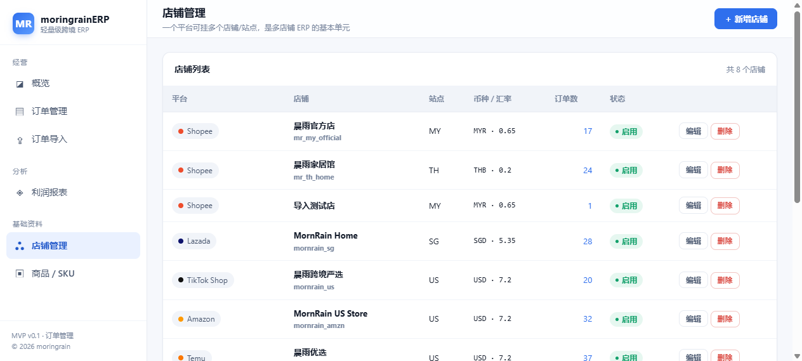

# 港湾ERP · 免费版（gangwanERP-free）

> **核心功能永久免费 · MIT 开源 · 可自托管** —— 专注「进销存 + 财务」的一体化企业经营管理平台

<div align="center">


官网 [gangwan123.com](https://gangwan123.com) · [产品与价格](https://gangwan123.com/product/) · [在线文档](https://gangwan123.com/faq/)

</div>

---

## 目录

- [这是什么](#一这是什么)
- [版本对比](#二版本对比按需选择)
- [功能清单](#三免费版功能清单41-个模块--9-条主线)
- [界面预览](#界面预览)
- [环境要求](#四环境要求)
- [快速开始](#五快速开始)
- [目录结构](#六目录结构)
- [二次开发约定](#七二次开发约定必读)
- [WordPress 插件](#八配套-wordpress-插件)
- [路线图](#九路线图)
- [商业版与支持](#十商业版与支持)
- [常见问题](#十一常见问题)
- [贡献与安全](#十二贡献与安全)
- [许可](#十三许可)

---

## 一、这是什么

港湾ERP 是一套面向中小企业经营团队的**一体化企业经营管理平台**：以进销存与财务为主线，把
「采购 → 入库 → 销售 → 出库 → 收款 → 核算利润 → 补货」跑成一条闭环，并内置电子审批流程、
财务报表与经营报表。

本仓库是**免费版（Free Edition）**，采用 **Open Core（开放核心）** 模式：

| | 说明 |
|---|---|
| **免费版**（本仓库） | 核心业务主线 **永久免费**、MIT 许可、源码全开放、可自托管、可商用 |
| **专业版 / 企业版** | 托管运维、自动备份、专属支持、智能分析与定制开发等**增值服务**，按需付费 |

一句话：**不靠限制功能赚钱，靠替你省事赚钱。**
有技术能力就自己部署免费版，零成本；不想折腾服务器、需要保障与响应速度，就买托管服务。

---

## 二、版本对比：按需选择

| 能力 | 免费版（本仓库） | 专业版（SaaS 托管） | 企业版（定制 / 私有化） |
|---|---|---|---|
| 价格 | **¥0 / 永久免费** | **¥199 / 月起**（含 3 个用户） | 按项目报价 |
| 进销存 + 财务核心功能 | ✅ 全部包含（41 个模块） | ✅ 包含 | ✅ 包含 |
| 服务器部署与维护 | 自行部署（提供一键脚本） | ✅ 官方一键托管 | ✅ 私有化部署 |
| 数据备份 | 自行备份 | ✅ 每日自动异地备份 | ✅ 实时热备 |
| 技术支持 | GitHub Issues 社区互助 | ✅ 1 对 1 专属客服 | ✅ 7×24 响应 |
| 智能经营分析 / AI 洞察 | 基础报表 | ✅ 智能经营分析 | ✅ 定制开发 |
| 企业套件（CRM / PM / MES / OA / EHR / 商城等） | 免费版不含 | ✅ 按需开通 | ✅ 全量 + 定制 |
| 二次开发与对接 | ✅ 自由修改源码 | ✅ 可协助 | ✅ 定制开发 |
| 数据归属 | 在你自己的服务器 | 独立库隔离，可随时导出 | 完全私有 |

> 需要专业版或企业定制：[联系页](https://gangwan123.com/contact/) · [产品与价格](https://gangwan123.com/product/)

---

## 三、免费版功能清单（41 个模块 / 9 条主线）

| 主线 | 模块 |
|---|---|
| **经营** | 经营概览、产品路线图、订单管理、订单导入 |
| **零售管理** | 门店开单、零售单、零售退货、会员管理 |
| **销售管理** | 销售订单、客户管理、报价单、销售退货 |
| **采购管理** | 采购管理（含一键补货）、请购申请 |
| **仓库管理** | 库存总览、仓库与分仓、仓库调拨、组装拆卸、库存盘点、其他出入库 |
| **财务管理** | 财务总览、资金账户、收支流水、预付款管理、对账中心、账务台账 |
| **报表查询** | 利润报表、财务报表、经营报表、综合查询（全局搜索）、报表设计 |
| **系统管理** | 平台对接（拉单）、系统状态、账号管理、操作审计、角色权限、系统参数、菜单管理 |
| **流程中心** | 流程目录、我的待办、我发起的（内置 **35 个电子流程模板**） |

其他能力：**多平台订单归集**、**自动利润核算**、**物流轨迹回写**、**库存唯一出入口（StockService）**、
**细粒度 RBAC（15 个权限点）**、**操作审计留痕**、**CSV 报表导出**。

> 机器可读清单：[`docs/modules.json`](docs/modules.json)（由 `php artisan modules:export-json` 生成，
> 官网 WordPress 插件的「模块中心」直接通过 GitHub raw 读取这份文件）。

### 界面预览

| 经营概览 | 订单管理 | 订单详情 |
|---|---|---|
|  |  |  |

| 经营报表 | 店铺管理 |
|---|---|
|  |  |

---

## 四、环境要求

| 项目 | 要求 |
|---|---|
| PHP | 8.3 及以上（需 `pdo_sqlite`，生产建议 `pdo_mysql`） |
| 数据库 | SQLite（开箱即用）/ MySQL 5.7+ / MariaDB 10.3+ |
| 依赖管理 | Composer 2.x |
| Web 服务 | 任意支持 PHP 的服务器（`php artisan serve` 可直接跑） |
| 浏览器 | Chrome / Edge / Firefox / Safari 现代版本 |

不强制依赖任何第三方云服务，前端资源全部本地化（**零 CDN 依赖**）。

---

## 五、快速开始

### 方式一：一键脚本（推荐）

```bash
# Windows
setup.bat

# Linux / macOS
bash setup.sh
```

脚本自动完成：环境检查 → Composer 依赖安装 → 生成 `.env` 与 APP_KEY → 数据库迁移 → 初始化演示数据。

### 方式二：手动部署

```bash
git clone https://github.com/mornrain-lin/gangwanERP-free.git
cd gangwanERP-free

composer install
cp .env.example .env
php artisan key:generate

# SQLite 开箱即用（生产建议改 MySQL）
touch database/database.sqlite
php artisan migrate --force
php artisan db:seed --force

php artisan serve          # 默认 http://127.0.0.1:8000
```

> 生产部署（Linux + Nginx + PHP-FPM）：站点根目录指向 `public/`，
> `storage/` 与 `bootstrap/cache/` 需可写，`.env` 中 `APP_ENV=production`、`APP_DEBUG=false`。

### 演示账号

初始化演示数据后可用：

管理员账号由 `.env` 控制（`db:seed` 时自动创建）：

```ini
INIT_ADMIN_EMAIL=admin@gangwan.local     # 默认管理员邮箱
INIT_ADMIN_PASSWORD=admin123             # 模板默认值，请改成你自己的强口令
```

未设置 `INIT_ADMIN_PASSWORD` 时会跳过管理员创建（不会生成弱口令账号）。
创建后到「系统管理 → 账号管理」添加员工账号，并按需分配角色权限。

> ⚠️ 公网部署前务必修改默认口令，并清空演示数据。

---

## 六、目录结构

```
├── app/
│   ├── Http/Controllers/     # 控制器（按业务分组）
│   ├── Models/               # 数据模型
│   ├── Services/             # 服务层：业务唯一出入口
│   │   ├── Inventory/StockService.php   # 库存唯一出入口（禁止直接改 products.stock）
│   │   ├── Finance/FinanceService.php   # 资金流水唯一出入口
│   │   ├── Sales/ Retail/ Purchase/ …   # 各业务生命周期
│   │   └── Workflow/WorkflowService.php # 审批流引擎（含业务回调钩子）
│   ├── Support/ProfitCalculator.php     # 利润核算唯一入口
│   └── Console/Commands/                # orders:sync 拉单 / modules:export-json 等
├── config/
│   ├── modules.php           # 模块注册表（侧边栏与路线图唯一数据源）
│   ├── permissions.php       # 权限点目录（15 项）
│   └── workflows.php         # 电子流程模板（35 个）
├── database/migrations/      # 增量迁移
├── docs/
│   ├── modules.json          # 模块快照（GitHub 模块中心数据源）
│   └── screenshots/          # 界面截图
├── resources/views/          # Blade 视图 + 本地 CSS
├── routes/web.php            # 路由（auth 组 + permission 中间件）
└── wordpress/gangwan-erp/    # 官方 WordPress 插件（站点集成用）
```

---

## 七、二次开发约定（必读）

1. **零外部 CDN**：CSS / JS 全部本地化在 `public/`，不引入前端构建链。
2. **金额口径隔离**：订单表的平台币字段与人民币字段严格分离，靠 `exchange_rate` 折算。
3. **利润核算唯一入口**：所有利润计算走 `App\Support\ProfitCalculator`，禁止在控制器 / 视图里另写公式。
4. **库存唯一出入口**：任何库存加减必须走 `App\Services\Inventory\StockService`，并写 `stock_movements` 流水。
5. **资金唯一出入口**：`App\Services\Finance\FinanceService::record()`（写流水 + 改余额同一事务）。
6. **新增平台不改业务代码**：实现 `PlatformConnector` 接口后在 `PlatformConnectorFactory` 注册即可。
7. **菜单不硬编码**：侧边栏由 `config/modules.php` 声明式驱动，新增模块只改这一个文件。
8. **权限成对**：`config/modules.php` 标 `permission` 的模块，路由必须挂 `permission:key` 中间件。

---

## 八、配套 WordPress 插件

`wordpress/gangwan-erp/` 是官方维护的 WordPress 插件，把 ERP 能力带进站点：

- ERP 工具（自定义文章类型 `tool` + 使用场景分类 `scenario`）与前台卖家工具台
- 商品库存、订单、采购、客户供应商、财务资金、经营报表等数据表与后台页面
- **GitHub 模块中心**：后台直接查看本仓库的模块清单与最近提交（读取 `docs/modules.json`，12 小时缓存）

安装：把 `wordpress/gangwan-erp/` 整个目录上传到 `wp-content/plugins/`，后台启用即可（纯 PHP + `$wpdb`，零外部依赖）。

---

## 九、路线图

| 阶段 | 内容 | 状态 |
|---|---|---|
| v1.0 | 经营 / 零售 / 销售 / 采购 / 仓库 / 财务 / 报表 / 系统 / 流程 九条主线（41 模块） | ✅ 已发布 |
| v1.1 | 平台 OpenAPI 对接扩展（更多电商平台适配器）、报表自定义增强 | 🟡 规划中 |
| v1.2 | 移动端适配优化、批量导入导出工具箱 | ⬜ 待启动 |
| v2.0 | 企业套件按需接入（CRM / PM / OA 等，属商业版范畴） | ⬜ 商业版 |

欢迎在 [Issues](https://github.com/mornrain-lin/gangwanERP-free/issues) 投票或提需求，
优先级会参考社区反馈排序。

---

## 十、商业版与支持

免费版永久免费，但我们**需要可持续的收入来维持长期维护**——这也是对使用者的责任：
只有团队能全职投入，你的数据资产与业务系统才有长期保障。

- **专业版（¥199/月起）**：官方托管、每日异地备份、1 对 1 客服、智能经营分析、企业套件按需开通
- **企业版（定制报价）**：私有化部署、7×24 响应、定制开发与系统集成
- **单次服务**：部署实施、数据迁移、二次开发，均按项目报价

👉 [查看价格与对比](https://gangwan123.com/product/) · [联系我们获取报价](https://gangwan123.com/contact/)

---

## 十一、常见问题

**Q：免费版真的免费吗？会突然收费吗？**
A：本仓库以 MIT 许可发布，核心业务主线永久免费、可商用、可修改、可再分发。我们不会把已开放的免费版功能改为收费；
收入来自托管与增值服务，而不是收回免费功能。

**Q：为什么还要推出付费版？**
A：为了提供稳定的服务器、及时的问题响应与持续的功能迭代。免费版适合有技术能力、愿意自部署的团队；
付费版适合追求效率与稳定的成长型企业。

**Q：我的数据安全吗？**
A：免费版部署在你自己的服务器，数据完全由你掌控；专业版采用独立库隔离与加密传输、每日异地备份，可随时导出。

**Q：可以商用 / 二次开发后售卖吗？**
A：可以，MIT 许可允许，只需保留版权与许可声明。但请注意：不得使用「港湾ERP」品牌名义对外提供服务。

---

## 十二、贡献与安全

- 提交 Bug / 需求：使用 [Issue 模板](https://github.com/mornrain-lin/gangwanERP-free/issues/new/choose)
- 参与开发：请先阅读 [`CONTRIBUTING.md`](CONTRIBUTING.md)（分支策略、代码规范、约定清单）
- 安全漏洞：**请勿公开 Issue**，按 [`SECURITY.md`](SECURITY.md) 私下报告
- 行为准则：参与本项目即视为接受 [`CODE_OF_CONDUCT.md`](CODE_OF_CONDUCT.md)

如果这个仓库对你有帮助，欢迎点一个 ⭐ Star —— 这是开源项目最容易获得、也最实在的支持。

---

## 十三、许可

[MIT License](LICENSE) —— 允许免费使用、复制、修改、合并、发布、分发、再许可与出售（含商业用途），
唯一条件是保留版权与许可声明。软件按「现状」提供，不含任何担保。

---

## 相关链接

- 官网：<https://gangwan123.com>
- 产品与价格：<https://gangwan123.com/product/>
- 常见问题：<https://gangwan123.com/faq/>
- 更新日志：[`CHANGELOG.md`](CHANGELOG.md)
- 商业版咨询（专业版 / 企业版）：<https://gangwan123.com/contact/>
