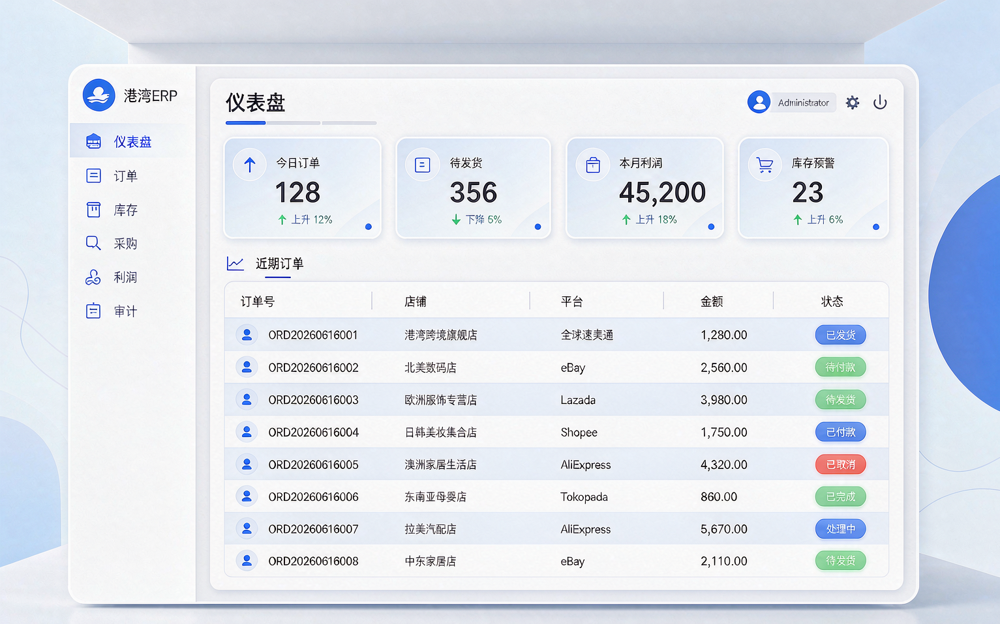
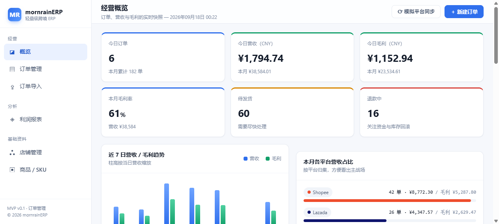
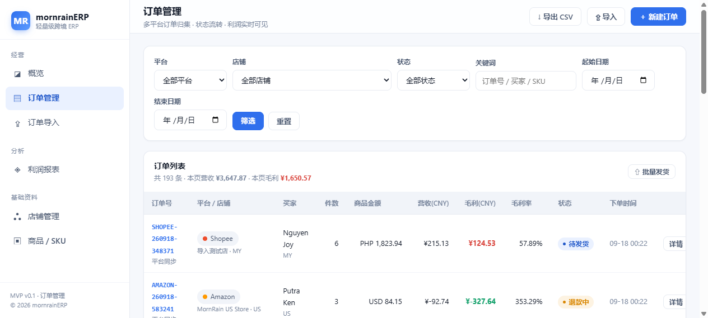
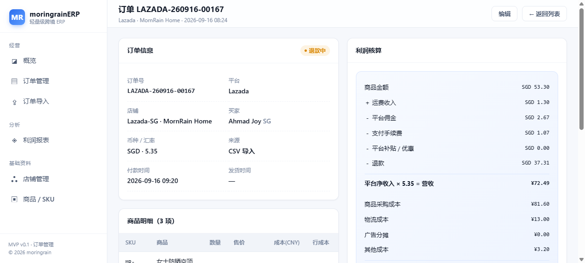
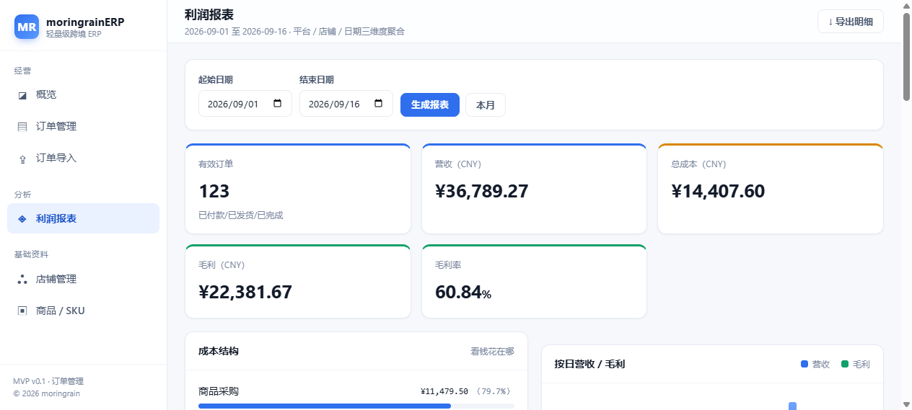

# 晨雨ERP

> 全功能企业一体化管理平台 · 零售 / 采购 / 销售 / 仓库 / 财务 / 报表 / 流程 / CRM / 企业套件（v1.1）
> 产品定位：**让每一单利润算得清，让整个企业跑得顺** —— 为跨境电商小团队打造的轻量级一体化 ERP

面向跨境电商小团队的轻量级一体化 ERP。核心解决四件事：**多平台订单归集 → 库存与发货闭环 → 自动核算利润 → 团队协同**。
v0.7 在原有电商主链路之上，铺开**全模块架构**：仓库（多仓/调拨/组装拆卸/盘点）、财务（账户/收支/预付款/对账）、
销售（订单/客户/报价）、零售（开单/会员/退货）、流程中心（50+ 电子审批）、财务报表、经营报表、系统状态，
并以「产品路线图」总览全部模块进度。当前版本跑通「登录 → 拉单/录单 → 发货扣库存 → 对账 → 算利润 → 补货建议」主链路。

v0.8 补齐经营闭环与企业管理：**销售退货**（退货入库回补库存 + 退款记账）、**账务台账**（期初/期末/科目总账）、
**综合查询**（13 类对象一搜即得）、**细粒度角色权限**（14 个权限点 + 角色分配 + 侧边栏按权可见）、
**系统参数**（公司名称 / 月度额度 / 默认安全库存），企业套件首个模块 **CRM**（线索 → 商机 → 赢单转销售订单）落地。

v0.9 把「企业一体化」推向纵深：**请购申请**（请购 → 电子审批流 → 一键转采购单，采购闭环第一环）、
**PM 项目管理**（立项 / 四列任务看板 / 工时填报 / 进度自动推导）、**菜单管理**（config 声明式基底之上的
覆盖式配置：显隐 / 排序 / 自定义链接）、**ADM 行政资产**（台账 + 领用退库送修报废全流程留痕）、
**OA 办公**（公告广播 + 团队日程）。

v1.0 完成企业套件全量收官，路线图 48 个模块全部 `ready`、0 规划中：
**MES 制造执行**（生产工单 / 工序报工 / 领退料 / 质检，完工经 `StockService` 入库）、
**EHR 人力**（员工档案 / 考勤 / 请假走审批流 / 薪资）、
**AI 经营助手**（规则式经营洞察 / 异常预警 / 智能建议，本地计算无外部依赖）、
**商城**（商品上架关联 ERP 库存 / 商城前台 / 购物车 / 下单 / 支付回执 / 履约退款，库存唯一出入口）。
全站业务表增至 63 张，细粒度权限点 22 项，企业套件八大模块（CRM / PM / MES / ADM / OA / EHR / AI / 商城）全部上线。

**双仓库结构（模型一）**：对外公开的仓库只包含 MIT 许可的**免费核心**；CRM / PM / MES / ADM / OA / EHR /
薪资 / 考勤 / 招聘 / 云售后 / 论坛 / 问卷 / AI / 商城等收费模块以独立私有包
`mornrain/erp-premium` 分发，公开仓库只保留「升级」入口与锁定页。
边界、授权与纵深防御详见 [PREMIUM.md](PREMIUM.md)。

> **仓库身份**：`mornrain-lin/MornrainERPfree` 为**免费版发行仓库**（MIT），
> 只含免费核心与「升级」锁定桩，**不含任何收费模块源码**（`packages/` 已排除）。
> 收费模块源码位于私有主库 `mornrain-lin/MornrainERPproplus` 的 `packages/` 目录。


**多组织核算（免费能力）**：v1.1 起支持三级组织（集团 → 公司 → 部门）、按组织数据隔离，
以及**跨组织合并报表 / 内部往来抵消 / 集团汇总**。27 张业务表带 `organization_id`，
通过全局作用域自动隔离；顶栏可切换当前组织；管理员可跨组织查看并维护组织树。
迁移自动播种默认根组织并回填既有数据，旧安装平滑升级。
合并核算采用「镜像流水 + 显式抵消登记」，口径、抵消规则、币别与权限见
[CONSOLIDATION.md](CONSOLIDATION.md)；免费/收费边界见 [PREMIUM.md](PREMIUM.md)。

---

## 免费版 / 付费版 与「双系统」总览

晨雨ERP 以**同一套免费核心**对外提供两条产品形态（双系统）。两条形态都只分发
**免费核心**；收费模块（`mornrain/erp-premium`）只在私有仓库中版本化与分发，任何 clone 公开仓库
的人都只能得到免费能力。免费/收费的边界、授权与纵深防御见 [PREMIUM.md](PREMIUM.md)。

| 系统 | 形态 | 许可证 | 免费范围 | 付费解锁方式 |
|------|------|--------|----------|--------------|
| **晨雨ERP（应用）** | Laravel Web 应用（本仓库主体） | MIT | 免费核心 + 多组织合并核算 | 激活码 → 专业版 / 企业版 |
| **晨雨ERP（WordPress 插件）** | `wordpress/gangwan-erp`（独立插件） | GPL-2.0-or-later | 插件全部功能免费 | 插件对接**已付费**的 ERP 实例，复用其付费模块；插件自身不收费 |

### 套餐等级（应用侧，由 `config/plan.php` 驱动）

| 等级 | 订单额度 | 解锁范围 |
|------|----------|----------|
| **免费版 free** | 每月 **400 单**（超量阻断新建/导入/拉单，次月 1 日自动重置） | 全部免费核心模块（含多组织合并核算） |
| **专业版 pro** | 不限量（额度置 0） | 免费全部 + CRM / PM / MES / ADM / OA / EHR / 多班次考勤 / 薪资 / 招聘 / 云售后 / 论坛 / 问卷 |
| **企业版 enterprise** | 不限量 | 在 pro 之上再解锁 AI 经营助手 / 商城 / 优惠券 / 促销活动 / 商品评价 |

> 额度与套餐是「路由门禁 `EnsurePlan` + 菜单锁定 `Premium::installed()`」的单一真相，
> 未安装私有包时所有收费菜单项展示为「升级」入口，点击进入锁定引导页，**不含任何收费业务逻辑**。

---

## 界面预览

| 经营概览 | 订单管理 |
|---|---|
|  |  |

| 订单详情（利润拆解） | 利润报表 |
|---|---|
|  |  |

---

## 一、为什么是这套设计

网站的宣传口径是：*免费版每月 400 单、对接 20+ 主流平台、自动归集平台佣金/广告费/物流成本与退款，毛利误差 2% 以内*。

这套 MVP 就是围绕这句话做的产品化落地：

| 官网卖点 | MVP 中的实现 |
|---|---|
| 对接 20+ 主流平台 | `platforms` 表预置 **21 个平台**，含默认佣金率 / 手续费率 |
| 自动归集成本 | `orders` 表拆分平台币 / 人民币两类字段，佣金·手续费·物流·广告·退款逐项落表 |
| 毛利误差 ≤2% | `ProfitCalculator` 统一口径计算，全部折算为 CNY，杜绝手工心算 |
| 多店铺 | `shops` 表支持「一个平台多店铺多站点 + 独立汇率」 |
| 400 单/月额度 | `QuotaService` 按自然月统计新建订单，免费版超 400 单阻断新建并引导升级 |

---

## 二、技术栈

| 层 | 选型 | 说明 |
|---|---|---|
| 框架 | Laravel 13.32 | 与现有 Linux + Nginx + PHP 8.3 + Redis 栈一致，零额外运维 |
| 语言 | PHP 8.3.33（NTS） | 使用 `enum` 状态机、类型化属性等特性 |
| 数据库 | SQLite（开发）/ MySQL 8（生产） | 切库只需改 `.env` 的 `DB_CONNECTION` |
| 视图 | Blade + 自研本地 CSS | **不依赖任何外部 CDN**，资源全部本地化 |
| 前端增强 | 原生 JS（约 60 行） | 订单明细动态增删、费率自动试算，无构建步骤 |

> 遵从既有架构约定：零插件、资源本地化、不引入 Elementor / Divi 类重前端。

---

## 三、目录结构

```
mornrainerp/
├── app/
│   ├── Enums/
│   │   ├── OrderStatus.php          # 订单状态机（含流转规则、UI 配色）
│   │   ├── ShipmentStatus.php       # 物流状态
│   │   └── POStatus.php             # 采购单状态机（草稿/已下单/已收货/已取消）
│   ├── Http/Controllers/
│   │   ├── AuthController.php       # 登录 / 登出 / 修改密码
│   │   ├── DashboardController.php  # 经营概览（含环比、库存预警、额度与广告费）
│   │   ├── InventoryController.php  # 库存总览 / 采购建议 / 入库出库盘点
│   │   ├── OrderController.php      # 订单 CRUD / 状态流转 / 发货（扣库存）/ 导入导出
│   │   ├── ProductController.php    # 商品 SKU 管理
│   │   ├── AuditController.php      # 操作审计日志（只读检索）
│   │   ├── PurchaseController.php   # 采购单 CRUD / 收货入库 / 状态流转 / 按建议生成
│   │   ├── ReportController.php     # 利润报表 + 财务报表 + 经营报表 + CSV 导出
│   │   ├── ShipmentController.php   # 物流轨迹刷新（单条 / 全部在途）
│   │   ├── SupplierController.php   # 供应商 CRUD / 启用停用
│   │   ├── ShopController.php       # 店铺管理
│   │   ├── SyncController.php       # 平台对接（凭证配置 / 手动拉单）
│   │   ├── UserController.php       # 账号管理（仅管理员）
│   │   ├── ModuleController.php     # 规划中模块落地页（module.hub）
│   │   ├── RoadmapController.php    # 产品路线图总览（读 config/modules 统计）
│   │   ├── WarehouseController.php  # 多仓库 / 调拨 / 组装拆卸 / 其他出入库 / 盘点
│   │   ├── FinanceController.php    # 财务总览 / 账户 / 收支流水 / 预付款 / 对账
│   │   ├── SalesController.php      # 销售订单 / 客户 / 报价单
│   │   ├── RetailController.php     # 门店开单（POS）/ 零售单 / 退货 / 会员
│   │   ├── WorkflowController.php   # 电子审批流（目录 / 待办 / 我发起的 / 审批）
│   │   ├── SystemController.php     # 系统状态 / 缓存清理（仅管理员）
│   │   ├── RequisitionController.php # 请购申请（草稿→审批→转采购单，v0.9）
│   │   ├── PmController.php         # PM 项目管理（看板 / 工时，v0.9）
│   │   ├── MenuController.php       # 菜单管理（显隐 / 排序 / 自定义链接，v0.9）
│   │   ├── AdmController.php        # ADM 行政资产（领用退库送修报废，v0.9）
│   │   ├── OaController.php         # OA 办公（公告 / 日程，v0.9）
│   │   ├── MesController.php        # MES 制造执行（工单 / 报工 / 领退料 / 质检，v1.0）
│   │   ├── HrController.php         # EHR 人力（员工 / 考勤 / 请假 / 薪资，v1.0）
│   │   ├── AiController.php         # AI 经营助手（洞察 / 预警 / 建议，v1.0）
│   │   └── MallController.php       # 商城（上架 / 前台 / 购物车 / 订单 / 支付 / 履约，v1.0）
│   ├── Http/Middleware/
│   │   ├── Authenticate.php         # 未登录跳登录页并记住目标地址
│   │   └── EnsureAdmin.php          # 管理员闸门
│   │   └── EnsurePermission.php     # 细粒度权限闸门（permission:key，管理员放行）
│   ├── Models/                      # User / Platform / Shop / Product / Order /
│   │                                # OrderItem / Shipment / SyncLog / StockMovement /
│   │                                # Supplier / PurchaseOrder / PurchaseOrderItem /
│   │                                # ActivityLog
│   │                                # —— v0.7 新增 ——
│   │                                # Warehouse / WarehouseStock / StockTransfer / Assembly
│   │                                # FinanceAccount / FinanceFlow / FinancePrepayment /
│   │                                # FinanceReconciliation
│   │                                # Customer / SaleOrder / SaleOrderItem / SaleQuote
│   │                                # RetailMember / RetailSale / RetailSaleItem / RetailReturn
│   │                                # WorkflowInstance / WorkflowInstanceLog
│   │                                # —— v0.8 新增 ——
│   │                                # SaleReturn / SaleReturnItem
│   │                                # Role / Permission / Setting
│   │                                # CrmLead / CrmOpportunity / CrmFollowUp
│   │                                # —— v0.9 新增 ——
│   │                                # PurchaseRequisition / PurchaseRequisitionItem
│   │                                # PmProject / PmTask / PmTimesheet
│   │                                # AdmAsset / AdmAssetLog
│   │                                # OaAnnouncement / OaSchedule
│   │                                # —— v1.0 新增 ——
│   │                                # MesWorkOrder / MesOperation / MesMaterialIssue / MesQcRecord
│   │                                # HrEmployee / HrAttendance / HrLeave / HrSalary
│   │                                # MallProduct / MallCart / MallOrder / MallOrderItem
│   │                                # StockMovement 新增 TYPE_MALL_OUT（商城销售出库）
│   ├── Services/
│   │   ├── Audit/                                # 操作审计
│   │   │   └── AuditService.php                  # 统一埋点入口（自动补操作人/IP）
│   │   ├── Inventory/StockService.php          # 库存唯一出入口 + 采购建议 + 调拨/组装
│   │   ├── Logistics/                            # 物流轨迹回写
│   │   │   ├── CarrierTracker.php               # 轨迹接口
│   │   │   ├── MockCarrierTracker.php           # 演示轨迹生成器
│   │   │   └── TrackingService.php              # 拉取 → 回写 events → 推进签收
│   │   ├── PlatformSync/                       # 平台拉单适配层
│   │   │   ├── PlatformConnector.php           # 连接器契约
│   │   │   ├── GenericRestConnector.php        # 通用 REST OpenAPI 实现
│   │   │   ├── PlatformConnectorFactory.php    # 按平台注册连接器
│   │   │   ├── NormalizedOrder.php             # 平台订单标准形态
│   │   │   └── OrderSyncService.php            # 拉单 → 去重落库 → 写同步日志
│   │   ├── Quota/                              # 免费版额度控制
│   │   │   ├── QuotaService.php                # 月度新建订单额度
│   │   │   └── QuotaExceededException.php      # 超额异常
│   │   ├── Finance/FinanceService.php          # 资金唯一出入口（流水+余额同事务）
│   │   ├── Sales/SalesService.php              # 销售订单生命周期（确认/发货/回款/退货）
│   │   ├── Retail/RetailService.php            # 零售开单 / 退货 / 会员储值积分
│   │   ├── Workflow/WorkflowService.php        # 审批流引擎（发起/同意/驳回/业务回调）
│   │   ├── Crm/CrmService.php                  # CRM：线索流转 / 转客户 / 商机推进 / 跟进
│   │   ├── Purchase/PurchaseRequisitionService.php # 请购：提交/撤回/转采购单（v0.9）
│   │   ├── Pm/PmService.php                    # PM：项目 / 任务 / 工时（v0.9）
│   │   ├── Adm/AdmService.php                  # ADM：资产流转（v0.9）
│   │   ├── Oa/OaService.php                    # OA：公告 / 日程（v0.9）
│   │   └── Support/
│   │       ├── ProfitCalculator.php            # 利润核算核心
│   │       └── MenuConfig.php                  # 菜单合并层：config 基底 + DB 覆盖（v0.9）
├── app/Console/Commands/SyncOrders.php     # php artisan orders:sync（可挂定时）
├── app/Console/Commands/TrackShipments.php # php artisan shipments:track（可挂定时）
├── config/plan.php                          # 套餐与额度（ERP_PLAN / ERP_FREE_QUOTA）
├── config/modules.php                       # 模块注册表：驱动侧边栏导航 + 路线图
├── config/permissions.php                   # 权限点目录（22 项，与路由中间件对应）
├── database/
│   ├── migrations/                  # 63 张业务表（电商主链 + 仓库 4 + 财务 4 +
│   │                                #  销售 4 + 零售 4 + 流程 2 + 退货 2 + 权限 4 +
│   │                                #  参数 1 + CRM 3 + 请购 2 + PM 3 + ADM 2 + OA 3 +
│   │                                #  MES 4 + EHR 4 + 商城 4，均为增量迁移）
│   └── seeders/                     # AdminUser + Platform + Supplier + DemoData +
│                                    #  Inventory + RolePermissionSeeder（角色/权限/参数）
├── public/css/app.css               # 本地后台样式（自研，含额度条与物流时间线）
├── resources/views/                 # layouts / dashboard / orders / inventory / sync /
│                                    # shops / products / reports / users / auth /
│                                    # purchases / suppliers / audit
│                                    # —— v0.7 新增 ——
│                                    # warehouses / finance / sales / retail /
│                                    # workflows / roadmap / module / system
│                                    # —— v0.8 新增 ——
│                                    # crm / roles / settings / query
│                                    # —— v0.9 新增 ——
│                                    # requisitions / pm / menus / adm / oa
├── scripts/
│   └── requirements-check.php       # PHP 版本与扩展预检（setup 脚本共同调用）
├── setup.bat / start.bat / stop.bat # Windows 一键部署 / 启动 / 停止
├── setup.sh                         # Linux / macOS 一键部署
└── routes/
    ├── web.php                      # 后台路由（auth / admin / permission 中间件）
    └── console.php                  # 定时拉单 + 每日 08:00 物流轨迹刷新开关
```

---

## 四、数据模型（ER）

```
platforms (平台)
   │ 1
   │ n
shops (店铺) ── 独立币种 + 汇率 + OpenAPI 凭证（AppSecret 加密存储）
   │ 1
   │ n
orders (订单) ──┬── n order_items (明细) ── n→1 products (SKU / 采购成本 / 库存)
                │                                    │ 1
                │                                    │ n
                │                              stock_movements (库存流水)
                └── n shipments (物流 / 发货)

users (账号 admin/staff) ── 操作人，写入库存流水
sync_logs (同步日志) ── n→1 shops

suppliers (供应商) ── 1 n ── purchase_orders (采购单) ── n purchase_order_items
purchase_orders ── n→1 users (created_by)
purchase_order_items ── n→1 products   # 收货时按明细回写库存
activity_logs (审计) ── n→1 users（user_id 可空：登录失败等未登录场景）
                     └─ 多态 subject_type + subject_id 指向被操作对象

—— v0.7–v0.8 新增（电商主链之外的模块表全貌）——

warehouses (仓库) ── 1 n ── warehouse_stocks (分仓库存) ── n→1 products
stock_transfers (调拨单) ── 来源仓 → 目标仓，执行即双仓增减
assemblies (组装拆卸单) ── 母件 ⇄ 子件，执行即按 BOM 出入库
finance_accounts (资金账户) ── 1 n ── finance_flows (收支流水，写流水即改余额)
finance_prepayments (预付款/预收款) ── n→1 finance_accounts，核销只消耗额度
finance_reconciliations (对账单) ── n→1 finance_accounts
customers (销售客户) ── 1 n ── sale_orders (销售订单) ── n sale_order_items ── n→1 products
sale_returns (销售退货单) ── n→1 sale_orders，入库回补库存 + 退款记 CAT_REFUND_OUT
sale_quotes (报价单) ── 可转为销售订单（converted）
retail_members (零售会员) ── 1 n ── retail_sales (零售单) ── n retail_sale_items ── n→1 products
retail_returns (零售退货) ── n→1 retail_sales，原路退款 + 库存回补 + 积分回冲
workflow_instances (审批实例) ── 1 n ── workflow_instance_logs (审批记录)
roles (角色) ── n n ── permissions (权限点)（permission_role）
role_user (用户 ↔ 角色)；admin 与 is_super 角色绕过全部权限校验
settings (系统参数) ── key-value，覆盖套餐额度 / 默认安全库存 / 公司名称
crm_leads (线索) ── 转化后写入 customers；crm_opportunities (商机) ── n→1 customers
crm_follow_ups (跟进记录) ── 多态 followable（线索 / 商机）
purchase_requisitions (请购单) ── 1 n ── purchase_requisition_items；审批实例联动 workflow_instances，
  通过后转 purchase_orders（草稿态，明细带预估单价）
pm_projects (项目) ── 1 n ── pm_tasks (任务看板) ── 1 n ── pm_timesheets (工时，回写累计工时)
  项目进度 = 已完成任务 / 总任务，自动推导
adm_assets (行政资产) ── 1 n ── adm_asset_logs (领用/退库/送修/修复/报废留痕)
oa_announcements (公告，发布即全员广播) ；oa_schedules (日程) ── n n ── users（oa_schedule_user 参与人）
```

> 采购入库：收货时 `StockService::adjust(product, qty, 'po_in')` 写入 `stock_movements`，
> `type='po_in'` 标记为「采购入库」，与销售出库（`out`）共用同一条流水。
>
> 金额口径：**财务 / 销售 / 零售 / 仓库 / CRM 模块一律人民币（CNY）**，与 `orders` 表的
> 平台币口径严格隔离；跨境电商的汇率折算仍只发生在利润核算域。

### 订单表的金额口径（关键设计）

跨境 ERP 最容易算错利润的地方，就是**币种混用**。本设计把字段按口径硬隔离：

| 口径 | 字段 | 含义 |
|---|---|---|
| **平台币** | `goods_amount` / `shipping_income` / `discount_amount` / `platform_commission` / `payment_fee` / `refund_amount` | 平台后台看到的数字 |
| **人民币** | `shipping_cost` / `ad_cost` / `other_cost` | 卖家在国内实际掏的钱 |
| **换算** | `exchange_rate` | 平台币 → CNY 的桥 |

明细表冗余存储 `line_total`（售价小计）与 `line_cost`（成本小计），列表页用 `withSum` 聚合，**避免 N+1**。

---

## 五、利润核算公式

`app/Support/ProfitCalculator.php` 是唯一计算入口，全站统一调用：

```
平台净收入 = 商品金额 + 运费收入 − 平台补贴 − 平台佣金 − 支付手续费 − 退款
营收(CNY)  = 平台净收入 × 汇率
成本(CNY)  = 商品采购成本 + 物流成本 + 广告分摊 + 其他成本
毛利(CNY)  = 营收 − 成本
毛利率     = 毛利 ÷ 营收 × 100%
```

其中 `商品采购成本 = Σ(明细 unit_cost × quantity)`，`unit_cost` 在落单时从商品库快照，**历史调价不会污染旧订单**。

---

## 六、功能清单

### 功能与套餐对照（免费 / 专业版 / 企业版）

下表为 `config/modules.php` 模块注册表的权威映射；✅ = 该套餐即包含，🔒 = 需对应套餐激活码解锁。

| 模块分组 | 免费版 free | 专业版 pro | 企业版 enterprise |
|----------|:---:|:---:|:---:|
| 经营（概览 / 路线图 / 订单管理 / 订单导入） | ✅ | ✅ | ✅ |
| 零售管理（开单 / 零售单 / 退货 / 会员） | ✅ | ✅ | ✅ |
| 销售管理（订单 / 客户 / 报价 / 退货） | ✅ | ✅ | ✅ |
| 采购管理（采购 / 请购申请） | ✅ | ✅ | ✅ |
| 仓库管理（库存 / 分仓 / 调拨 / 组装 / 盘点 / 其他出入库） | ✅ | ✅ | ✅ |
| 财务管理（账户 / 流水 / 预付 / 对账 / 台账 / 内部往来） | ✅ | ✅ | ✅ |
| 报表查询（利润 / 财务 / 经营 / **合并报表** / 查询 / 报表设计） | ✅ | ✅ | ✅ |
| 系统管理（对接 / 状态 / 账号 / 审计 / 角色 / 参数 / 菜单 / 组织架构） | ✅ | ✅ | ✅ |
| 流程中心（目录 / 待办 / 我发起的） | ✅ | ✅ | ✅ |
| **CRM 客户关系** | 🔒 | ✅ | ✅ |
| **PM 项目管理** | 🔒 | ✅ | ✅ |
| **MES 制造执行** | 🔒 | ✅ | ✅ |
| **ADM 行政资产** | 🔒 | ✅ | ✅ |
| **OA 办公** | 🔒 | ✅ | ✅ |
| **EHR 人力 / 多班次考勤 / 薪资** | 🔒 | ✅ | ✅ |
| **招聘管理** | 🔒 | ✅ | ✅ |
| **云售后** | 🔒 | ✅ | ✅ |
| **论坛** | 🔒 | ✅ | ✅ |
| **问卷** | 🔒 | ✅ | ✅ |
| **AI 经营助手** | 🔒 | 🔒 | ✅ |
| **商城 / 优惠券 / 促销活动 / 商品评价** | 🔒 | 🔒 | ✅ |

> 多组织核算（三级组织树 + 按组织数据隔离 + 跨组织合并报表 / 内部往来抵消 /
> 少数股东权益 / 内部未实现利润 / 跨期抵消 / 合并快照）属于**免费核心**，不依赖私有包，
> 见 [CONSOLIDATION.md](CONSOLIDATION.md)。
>
> 免费版每月 **400 单**额度，由 `QuotaService` 按自然月统计新建订单；超额统一抛
> `QuotaExceededException` 并引导升级，已存在订单可继续维护。

### 1. 经营概览 `/`
- 今日 / 本月订单数、营收、毛利、毛利率
- **环比**：今日 vs 昨日、本月 vs 上月同期（涨红跌绿，基期为 0 显示 —）
- 待发货数、退款中数量预警
- **近 14 日**营收 / 毛利双柱趋势
- 本月各平台营收占比条（含各平台毛利率）
- **低库存预警条**：低于安全库存的 SKU 直接列出，可一键跳补货
- 待发货订单、最新订单速览（带实时毛利）

### 2. 订单管理 `/orders`
- **多维筛选**：平台 / 店铺 / 状态 / 关键词（订单号·买家·SKU）/ 日期区间
- 列表实时显示每单营收、毛利、毛利率；底部汇总本页合计
- **状态流转**：待付款 → 待发货 → 已发货 → 已完成；支持退款中 / 已退款 / 已取消，非法流转会被拦截
- **单条发货**：填物流商 + 运单号，自动生成物流记录、推进状态并**按明细扣减库存**
- **批量发货**：粘贴「订单号,运单号」多行，一次处理，失败行单独回报（同样扣库存）
- **退款完成自动回补库存**：状态流转到「已退款」时把发货时扣掉的库存还回去
- **CSV 导入**：同一订单号多行自动合并为一张订单 + 多条明细；平台按 code 匹配，店铺不存在自动创建
- **CSV 导出**：带 BOM 中文表头，Excel 直接打开不乱码，含利润核算结果列

### 3. 订单详情 `/orders/{id}`
- 订单信息、商品明细、物流记录三段式布局
- **利润核算面板**：从商品金额一路减到毛利，每一步都摊开给用户看

### 4. 利润报表 `/reports/profit`
- 任意日期区间，三维聚合：**按平台 / 按店铺 / 按日**
- 成本结构拆解（商品采购 / 物流 / 广告 / 其他）
- **亏损订单预警 Top 8**
- **SKU 毛利贡献 Top 10**
- **导出**：利润明细 CSV（营收 / 四项成本 / 毛利 / 毛利率）与订单 CSV，均带 BOM

### 5. 库存与采购 `/inventory`
- SKU 库存总览（库存、安全库存、累计销量、库存货值）
- **入库 / 出库 / 盘点**三种调整方式，每次变动写入 `stock_movements` 流水（含操作人）
- **低库存预警**：低于安全库存标黄、≤0 标红
- **采购建议**：`建议补货量 = 近 30 天销量 + 安全库存 − 当前库存`，并给出预估采购额
- 发货自动出库、退款完成自动回补，允许负库存（超卖要被看见，不悄悄抹平）

### 6. 平台对接 `/sync`（管理员）
- 店铺级 OpenAPI 凭证配置：`api_base` / `app_key` / `app_secret`
  - **AppSecret 加密落库**（Eloquent `encrypted` cast），页面永不回显
- **通用 REST 连接器**：`GET {api_base}/orders`，签名头
  `X-Signature = HMAC-SHA256(app_key + "\n" + timestamp + "\n" + "/orders", app_secret)`
- **自动去重**：按 `shop_id + order_no` upsert，明细按 SKU 更新，平台删掉的行同步清理
- **成本快照**：明细 `unit_cost` 落单时取商品库成本，历史调价不影响旧订单
- **同步日志**：每次拉单记录时间窗、拉取/新建/更新数、耗时与失败原因
- **手动 + 定时**双通道：页面点「立即同步」，命令行 `php artisan orders:sync --all`
  （`.env` 设 `SYNC_SCHEDULE_ENABLED=true` 后由 `schedule:run` 每小时执行）
- 新增平台只需实现 `PlatformConnector` 接口并在工厂注册，落库逻辑零改动

### 7. 登录与权限
- 全站后台强制登录（`/login`、`/logout` 除外），未登录自动跳登录页并记住目标地址
- 基础两级角色：**管理员**（等价超级角色，绕过全部权限校验）/ **运营**（按授权访问）
- 细粒度 RBAC（v0.8）：`permission:key` 中间件 + 角色权限分配，采购 / 仓库 / 财务 / 销售 / 零售 / 报表 / CRM / 系统管理均可按模块授权，侧边栏同步按权可见
- 登录失败统一文案（不暴露账号是否存在），登录接口按 IP 限流 10 次/分钟
- 个人可自助改密码；管理员可建号、重置密码、停用 / 删除账号（不能操作自己）

### 8. 基础资料
- 店铺管理 `/shops`：平台归属、站点、币种、汇率
- 商品 SKU `/products`：采购成本、重量、品类、**当前库存与安全库存**（成本是利润的输入项）

### 9. 免费版额度控制 `/`（概览）
- 套餐与额度由 `config/plan.php` 驱动（`ERP_PLAN` 默认 `free`，`ERP_FREE_QUOTA` 默认 `400`，设 `0` 为不限量）
- `QuotaService` 按 `orders.created_at` 自然月统计**新建**订单数，`remaining()` 不限量返 `null`
- 拦截点：手工录单（`OrderController::store`）、CSV 导入（`OrderController::import` 按去重后的净新增数校验）、平台拉单（`OrderSyncService` 在额度耗尽时跳过新建并计入 `skipped`/`blocked`）
- 超额时统一抛 `QuotaExceededException`，页面提示「本月订单额度已用完（已用/额度）。升级付费版可解除限制，或等待下月 1 日自动重置。」
- 概览页「本月订单额度」进度条：已用/限制、剩余数、`pct≥100` 标红

### 10. 采购单与供应商 `/purchases`（管理员）
- **采购单**：`purchase_orders` + 明细 `purchase_order_items`，状态机 `POStatus`（草稿→已下单→已入库→已取消），`recalcTotal()` 自动汇总行小计
- **完整生命周期**：新建（草稿/已下单）→ 编辑 → 标记下单 → 收货入库 → 取消 → 删除；列表支持按单号/状态/供应商筛选
- **收货入库**：`receive()` 在事务内对每条明细调用 `StockService::adjust(..., StockMovement::TYPE_PO_IN, ...)`，库存回写、流水类型标记为「采购入库」，PO 置已入库并写 `received_at`
- **编辑守卫** `editGuard()`：仅「草稿/已下单」可编辑；已有明细入库的单据禁止编辑，避免与库存流水对不上
- **删除守卫**：仅「草稿/已取消」可删除，删除时级联清理明细（不留孤儿行）
- **一键补货**：库存页「采购建议」可一键 `POST /purchases/from-suggestions` 生成草稿采购单
- 表单 `purchases/form.blade.php` 由新建/编辑共用，明细行可动态增删并实时算行小计与合计
- 供应商的维护见下方「13. 供应商管理」

### 11. 广告费自动归集 `/reports/profit`
- 利润公式已含 `广告分摊` 口径；本次在利润报表与概览补充**广告费聚合视图**
- 报表页新增三块 KPI：**广告费（CNY）**、`广告费占比 = 广告费 ÷ 营收`、`ROAS = 营收 ÷ 广告费`（广告费为 0 时 ROAS 显示 —）
- 概览页新增「本月广告费」与占比，便于运营监控投放效率
- 归集数据来自 `orders.ad_cost`（人民币口径，落单时录入），无需手工分摊

### 12. 物流轨迹回写 `/orders/{id}`
- 抽象 `CarrierTracker` 接口 + `MockCarrierTracker`（演示用，按 `shipped_at` 推算跨境 5 节点：揽收 → 运输中 → 到达目的国 → 派送中 → 已签收）
- `TrackingService` 拉取轨迹后回写 `shipments.events` / `last_tracked_at`；末节点含「签收」则自动把 `status` 推进 `delivered` 并写 `delivered_at`
- 页面入口：订单详情「批量刷新在途物流」按钮 + 每条运单「刷新」按钮，运单下方渲染 `<ul class="timeline">` 轨迹时间线
- 定时：`php artisan shipments:track`（刷新全部在途），`SYNC_SCHEDULE_ENABLED=true` 时由 `schedule:run` 每日 08:00 执行

> 接入真实物流商只需实现 `CarrierTracker` 接口并在 `AppServiceProvider` 重新 `bind` 即可，其余逻辑零改动。

### 13. 供应商管理 `/suppliers`（管理员）
- 完整 CRUD：名称（唯一校验）/联系人/电话/邮箱/地址/备注/启用状态；支持按名称·联系人·电话·邮箱搜索、按启用状态筛选
- **停用代替删除**：已关联采购单的供应商禁止删除，只能停用，以保留历史单据归属；启用后重新出现在采购单下拉
- 采购单下拉只列启用中的供应商；**编辑采购单时，若原供应商已停用也会保留在下拉里**，避免归属被静默改掉
- 空状态直接给出「先新增一家」入口（此前只能靠 seeder 的演示数据，无法自建）

### 14. 操作审计 `/audit`（管理员）
- `activity_logs` 表记录：操作人 / 动作 / 对象（多态 `subject_type`+`subject_id`）/ 描述 / IP / UA / 时间
- `AuditService::log()` 为统一入口，自动补齐操作人与 IP；已埋点 **30+ 个动作**：
  登录（成功 / 失败 / 退出 / 改密码）、订单（创建 / 修改 / 删除 / 发货 / 批量发货 / 状态流转 / 导入）、
  采购（创建 / 修改 / 删除 / 下单 / 收货 / 取消）、库存调整、供应商、商品、店铺、账号管理、平台对接
- 只读检索页：按关键词 / 动作 / 操作人 / 时间范围（1·7·30 天·全部）筛选，分页 30 条
- 日志**只增不改**：不提供编辑与删除入口，保证可追溯性

### 15. 仓库管理增强 `/warehouses`（管理员）
- **多仓库**：`warehouses` + `warehouse_stocks` 分仓库存，支持设默认仓；`products.stock` 仍是全局总库存口径
- **仓库调拨**：调拨单（来源仓 → 目标仓）新建 → 执行双仓增减（同事务）→ 取消；未执行的调拨可取消
- **组装拆卸**：母件 ⇄ 子件按 BOM 出入库，执行即写库存流水；适合组合装、赠品拆包
- **其他出入库**：盘盈 / 盘亏 / 破损 / 领用等非采购非销售场景的统一入口
- **库存盘点**：按商品录入实盘数，自动与系统库存对比生成差异，经 `StockService` 校正
- 所有变动仍走 `StockService::adjust()` 唯一入口，流水含操作人

### 16. 财务管理 `/finance`（管理员）
- **资金账户**：现金 / 银行 / 支付宝 / 微信四类，余额实时反映全部流水
- **收支流水**：`FinanceService::record()` 是资金唯一出入口——写流水与改余额同一事务，杜绝「账钱两张皮」；
  收入分类（销售 / 退款收回 / 其他）× 支出分类（采购 / 物流 / 广告 / 佣金 / 手续费 / 退款 / 其他）
- **预付款 / 预收款**：创建时钱已离开/进入账户（记 `prepay` 流水）；**核销只消耗额度不动余额**；
  取消时按原方向反向退回余额
- **删除冲销**：删流水自动反向修正账户余额；`prepay` 类流水不可删，必须走预付款取消流程
- **对账中心**：系统余额 vs 实盘余额，差异自动判定 balanced / diff
- 一律人民币（CNY），与平台币 / 利润核算域隔离

### 17. 销售管理 `/sales`（管理员）
- **销售订单**：状态机 草稿 → 已确认 → 已发货 → 已完成（可取消），`getRemainingAttribute()` 实时算未回款
- **发货扣库存**：确认后发货，逐行走 `StockService` 扣减（与电商订单同一条流水体系）
- **登记回款**：可多次登记，累计不超过订单总额
- **客户管理**：名称唯一校验、启停、搜索筛选
- **报价单**：新建 → 发送 → 转销售订单（明细自动带入），衔接「报价 → 签单」闭环
- 表单带实时小计 / 合计 JS，明细行动态增删

### 18. 零售管理 `/retail`（管理员）
- **门店开单（POS）**：选商品 → 会员折扣与手动优惠叠加 → 选支付方式（现金/微信/支付宝/银行卡/储值）→ 开单调库存
- **储值支付**：扣会员余额，余额不足 422 拦截
- **积分**：¥1 = 1 积分；整单退货时积分同步回冲
- **零售退货**：整单退——库存回补 + 原路退款（储值退回余额）+ 积分回冲，一个动作三件事
- **会员管理**：开卡（M 前缀卡号）、储值、折扣率、积分余额、启停

### 19. 流程中心 `/workflows`（电子审批流）
- **50+ 电子流程目录**：采购 / 费用 / 用印 / 用车 / 请假 / 出差 / 加班 / 补卡 / 招聘 / 转正 / 调岗 /
  离职 / 合同 / 薪资 / 报销 / 付款 / 收款 / 退货 / 换货 / 补发 / 折扣 / 特价 / 礼包 / 样品 / 试用 /
  借用 / 领用 / 报废 / 转让 / 维修 / 年检 / 保险 / 证照 / 资质 / 知识产权 / 招标 / 投标 / 外包 /
  立项 / 验收 / 变更 / 结项 / 需求 / 设计 / 开发 / 测试 / 上线 / 回滚 等
- **三态视图**：流程目录 / 我的待办 / 我发起的
- **审批引擎** `WorkflowService`：发起 → 按流程定义的表单字段采集数据 → 同意 / 驳回 → 全程记录
  `workflow_instance_logs`，待办实时可操作

### 20. 企业套件（规划落地页）
CRM / PM / MES / ADM / OA / EHR / AI 助手 / 商城八大套件已挂「模块落地页」：
说明定位 + 功能清单 + 与已上线模块的衔接关系，侧边栏可见、点击不 404。
「产品路线图 `/roadmap`」全员可见，按分组展示全部模块的 ready / planned 状态与总体进度。

### 21. 财务报表 `/reports/finance`（管理员）
- 任意日期区间：总收入 / 总支出 / **净现金流**（= 期内资金净增加）/ 当前资金余额 / 销售应收 / 预付未核销
- **按月收入支出双柱趋势**
- **收入 / 支出分类汇总**（金额 + 占比条）
- 资金账户余额表、预付款未核销清单、近期流水明细
- **导出**：收支流水 CSV（带 BOM）

### 22. 经营报表 `/reports/business`（管理员）
- 销售分析：订单数 / 总额 / 已回款 / 应收余额 / 回款率，**按月销售趋势**、**客户销售 Top 10**
- 采购分析：订单数 / 总额，**按月采购趋势**、**供应商采购 Top 10**（含已入库单数）
- 库存分析：库存总量 / **库存总值**（按成本价）/ 低库存 SKU 数 / **分仓库存金额**
- 零售概览：开单数 / 金额 / 退货数 / 会员数
- 基础资料规模一览（客户 / 供应商 / SKU / 会员 / 账号）

### 23. 系统状态 `/system/status`（管理员）
- 运行环境：PHP / Laravel 版本、数据库驱动、时区、内存限制、调试模式开关
- 数据规模：10 张核心表记录数一览
- 存储占用：数据库文件 / 日志 / 框架缓存体积
- 套餐额度：本月订单额度进度条（≥90% 标红）
- **一键清理缓存**（`optimize:clear`，写入审计日志）

### 24. 模块注册表驱动导航 `config/modules.php`
- 全站侧边栏由 `config/modules.php` 声明式驱动：分组 → 模块（名称 / 图标 / 路由或落地页 / 管理员可见 / 权限键 / 状态）
- `status: ready` 直链路由；`planned` 走 `module.hub` 落地页，新增模块**零改布局代码**
- 同一份配置同时驱动「产品路线图」统计，导航与路线图永远一致

### 25. 销售退货 `/sales/returns`（管理员）
- 从已发货 / 已完成订单发起，按原明细行填数量（累计已退校验防超退）
- 状态机：待入库 → 已入库 → 已退款（或已取消）；入库经 `StockService` 回补库存
- 退款经 `FinanceService` 记支出（`refund_out`），选账户 + 可部分退
- 订单详情页直达「申请退货」，退货单详情页办理入库 / 退款 / 取消

### 26. 账务台账 `/finance/ledger`（管理员）
- 账户明细账：期初余额（当前余额 − 起始日起净发生额）/ 期间收入 / 支出 / 期末 / 流水数
- 科目总账：按收支分类汇总期间发生额 + 笔数 + 占比条
- 期间 + 账户筛选，流水明细分页，同条件 CSV 导出（带 BOM）

### 27. 综合查询 `/query`（全员）
- 一个关键词打通 13 类对象：跨境订单 / 销售订单 / 报价单 / 退货单 / 采购单 / 零售单 / 会员 / 资金流水 / 审批流程 / 商品 / 客户 / 供应商 / 仓库
- 分组限量展示 + 直达单据详情；scope 范围过滤；结果整体导出 CSV
- LIKE 通配符转义；资金流水组仅管理员命中（防余额泄漏）

### 28. 角色权限 `/roles`（管理员）
- 四表 RBAC：`roles` / `permissions` / `permission_role` / `role_user`，权限目录见 `config/permissions.php`（14 项）
- `EnsurePermission` 中间件按 `permission:key` 校验；admin 与超级角色（`is_super`）自动放行
- 财务写操作细粒度：`finance.account` / `finance.flow` / `finance.prepay` / `finance.reconcile`
- 侧边栏按权限键可见：授权员工只见授权模块；用户角色分配一键保存

### 29. 系统参数 `/settings`（管理员）
- 公司名称：驱动登录页 / 侧边栏品牌副标题
- 月度订单额度：覆盖 `config/plan.php`，`QuotaService` 直读，改后即时生效（0 = 不限量）
- 默认安全库存：商品未单独设置 `safety_stock` 时的低库存预警与采购建议回退值

### 30. CRM 客户关系 `/crm`（管理员）
- 线索全生命周期：新建 → 跟进（自动推进「已接触」）→ 已验证 → 转客户（写入 `customers`）
- 商机管道：初步接触 → 需求确认 → 方案报价 → 商务谈判 → 赢单 / 丢单
- 跟进记录多态挂接（线索 / 商机），看板含线索漏斗、商机管道金额、赢单率、待跟进
- 赢单且关联客户后，一键转销售订单并预填客户

### 31. 请购申请 `/requisitions`（管理员）
- 请购单：部门 / 优先级 / 期望到货 / 多明细（SKU + 预估单价，默认取商品成本价）
- 提交即发起电子审批（`purchase.requisition` 流程：直属主管 → 采购），审批结论由流程引擎**数据驱动回调**写回请购单（通过 / 驳回 / 撤回）
- 审批通过后一键转采购单（草稿态），明细与预估单价自动带入，衔接既有采购 / 收货闭环
- 状态机：草稿 → 审批中 → 已通过 → 已转采购单；驳回可修改后重新提交

### 32. PM 项目管理 `/pm`（管理员）
- 项目立项：负责人 / 关联客户 / 优先级 / 计划周期 / 预算（CNY）
- 四列任务看板：待处理 / 进行中 / 已完成 / 已阻塞，状态下拉即改即走，支持改派与删除
- 工时填报：按任务记流水并累加 `spent_hours`（服务层唯一入口，删除流水自动回滚）
- 项目进度 = 已完成任务占比，自动推导；项目支持暂停 / 完成 / 归档 / 恢复

### 33. 菜单管理 `/menus`（管理员）
- 在 `config/modules.php` 声明式基底之上做数据库覆盖（`settings.menu_config`）：**绝不在布局硬编码菜单**
- 分组 / 菜单显隐、分组序号排序、自定义链接（可挂指定分组或落入「自定义」分组，外链新窗打开）
- 隐藏只影响侧边栏，路由与权限校验照常生效（防「看不见但能进」）；「产品路线图」仍直读 config，产品真相与运营菜单解耦

### 34. ADM 行政资产 `/adm`（管理员）
- 资产台账：编号 / 分类 / 规格 / 原值 / 存放地点 / 保管人
- 流转：领用（闲置→在用，登记领用人）/ 退库 / 送修 / 修复 / 报废，全部同事务写流转日志
- 非法流转一律拦截（如在用不可再领用、报废后不可流转）；报废资产锁定主体字段仅可改备注

### 35. OA 办公 `/oa`（管理员）
- 公告：草稿 → 发布 → 撤回，支持置顶；**发布后仪表盘全员广播**（无权限用户只看内容、不出现管理链接）
- 日程：会议 / 拜访 / 截止，参与人多选，支持「我参与的 / 全部」与「近期 / 已过去」筛选
- OA 首页聚合公告流 + 我的近期日程（创建或参与）+ 我的草稿

---

## 七、本地运行

### 7.1 一键部署（推荐）

仓库自带跨平台部署脚本，双击或命令行执行即可完成「检测环境 → 装依赖 → 生成配置 → 建库迁移 → 灌演示数据」：

| 系统 | 脚本 | 作用 |
|---|---|---|
| Windows | `setup.bat` | 一键初始化（幂等，重复执行安全） |
| Windows | `start.bat` | 启动服务，默认 <http://127.0.0.1:8000> |
| Windows | `stop.bat` | 按端口查进程，**先显示 PID 再确认**才终止 |
| Linux / macOS | `setup.sh` | 一键初始化（生产机也可直接用） |

```bat
REM Windows：先初始化，再启动
setup.bat
start.bat
```

```bash
# Linux / macOS
./setup.sh
php artisan serve --host=127.0.0.1 --port=8000
```

脚本行为要点：

- **幂等**：`.env` 已存在则保留不动，`vendor/` 已存在则跳过 `composer install`，`APP_KEY` 已设置则跳过生成，库里已有数据则跳过 seed（避免重复灌演示订单）
- **自动探测运行时**：优先读 `PHP_BIN` / `COMPOSER_BIN` 环境变量 → 再找本机的 `.workbuddy/binaries/` 隔离环境 → 最后回落到 `PATH` 里的 `php` / `composer`
- **环境校验前置**：由 `scripts/requirements-check.php` 统一检查 PHP ≥ 8.2 与 `pdo_sqlite` / `mbstring` / `openssl` / `fileinfo` / `curl` / `zip` / `intl`，不满足直接退出并指出缺哪个
- **强制重灌数据**：`set FORCE_SEED=1` 后再跑（Windows）/ `FORCE_SEED=1 ./setup.sh`（Linux）

> 两个实现细节是踩过坑才定型的：
> 1. **`.bat` 内所有输出一律 ASCII 英文** —— cmd.exe 用 OEM 代码页解码批处理，中文提示会变乱码；中文说明放在本文档里。
> 2. **绝不在 `for /f ... in ('... "引号" ...')` 里嵌套引号** —— cmd 在**解析阶段**就会报错，哪怕该分支永不执行。所有 `findstr` / `where` / `netstat` 查询都先落临时文件，再用 `usebackq` 读取。

### 7.2 手动步骤

本项目已在本机装好**隔离的 PHP 运行环境**，开箱即用：

```
PHP 运行时：C:\Users\linga\.workbuddy\binaries\php\8.3.33\php.exe
Composer  ：C:\Users\linga\.workbuddy\binaries\composer\composer.phar
```

> 通用环境要求：PHP ≥ 8.3（需 `pdo_sqlite` / `mbstring` / `openssl` / `fileinfo` / `curl` / `zip` 扩展）+ Composer 2。
> 上述本机路径可用你自己的 `php` / `composer` 命令替代。

启动：

```bash
cd mornrainerp

# 0) 环境配置：复制 .env 并生成 APP_KEY
cp .env.example .env
php artisan key:generate

#    在 .env 里设置初始管理员（不设置则 db:seed 跳过建号，页面将无法登录）
INIT_ADMIN_EMAIL=admin@mornrain.local
INIT_ADMIN_PASSWORD=********      # 至少 8 位，建议上线后立即修改

# 1) 建库 + 迁移 + 灌演示数据（200 张订单 + 389 条明细 + 76 条物流 + 12 个 SKU 库存，共 51 张业务表）
php artisan migrate --force
php artisan db:seed --force

# 2) 启动开发服务器
php artisan serve --host=127.0.0.1 --port=8000
```

访问 <http://127.0.0.1:8000>，会先跳登录页。

> **演示账号**（仅本地演示用，生产环境务必改掉）
> | 角色 | 邮箱 | 密码 |
> |---|---|---|
> | 管理员 | `.env` 里的 `INIT_ADMIN_EMAIL` | `.env` 里的 `INIT_ADMIN_PASSWORD` |
> | 运营 | 由管理员在「账号管理」创建 | 创建时设置 |
>
> 运营账号可看概览、订单、利润报表、流程中心与产品路线图；
> 访问基础资料 / 平台对接 / 账号管理 / 仓库 / 财务 / 销售 / 零售 / 财务报表 / 经营报表 / 系统状态 /
> CRM / 请购 / PM / ADM / OA / 菜单管理会返回 403（按角色授权后逐项开放）。

> 提示：Windows 下 PHP 必须显式配置 `upload_tmp_dir`，否则文件上传会报
> `unable to create a temporary file`。本机 php.ini 已配好。

### 7.3 环境排障

| 现象 | 根因 | 处理 |
|---|---|---|
| 页面报 `could not find driver` | `.env` 写了 `DB_CONNECTION=mysql`，但 PHP 没装 `pdo_mysql` | 本机只有 `pdo_sqlite`，把 `.env` 改回 `DB_CONNECTION=sqlite` 即可；要上 MySQL 见第八节 |
| 访问 `127.0.0.1:8000` 返回 502 | 没有 PHP 进程在跑（服务已停） | 跑 `start.bat` |
| 端口被占用，起不来 | 上次的服务没关干净 | 跑 `stop.bat`，它会显示占用端口的 PID 并要你确认后才终止 |
| 改完 `.env` 不生效 | Laravel 缓存了配置 | `php artisan config:clear`（`setup.bat` 结尾会自动清一遍） |
| CSV 导入报 `unable to create a temporary file` | php.ini 未设 `upload_tmp_dir` | 在 php.ini 显式指定一个可写目录 |

> 本机 `.env` 曾被人改成 `DB_CONNECTION=mysql`（指向并不存在的 MySQL 服务），
> 导致环境整体起不来。SQLite 库里 22 张表、200 张订单的数据完好无损，
> 改回 `sqlite` 后即恢复正常——**数据与连接配置是分离的，改配置不会动数据**。

---

## 八、生产部署建议

沿用现有服务器架构（Linux + Nginx + PHP 8.3 + Redis）：

```bash
# 1) 切 MySQL（.env）
DB_CONNECTION=mysql
DB_HOST=127.0.0.1
DB_DATABASE=mornrainerp
DB_USERNAME=xxx
DB_PASSWORD=xxx

# 2) 缓存 / 会话切 Redis
#    任务为同步执行（QUEUE_CONNECTION=sync），当前未启用异步队列
CACHE_STORE=redis
SESSION_DRIVER=redis

# 3) 上线
composer install --no-dev --optimize-autoloader
php artisan migrate --force
php artisan config:cache && php artisan route:cache && php artisan view:cache
```

Nginx 站点根指向 `public/`，并按 Laravel 标准配置：
`try_files $uri $uri/ /index.php?$query_string;`

---

## 九、后续路线图

| 优先级 | 模块 | 状态 | 说明 |
|---|---|---|---|
| P0 | 平台 OpenAPI 对接 | ✅ 已交付 | 通用 REST 连接器 + 手动 / 定时拉单；接具体平台只需新增连接器实现 |
| P0 | 登录与权限 | ✅ 已交付 | 全站登录校验 + 管理员 / 运营两级角色 |
| P1 | 库存管理 | ✅ 已交付 | SKU 库存、安全库存、流水、发货扣减、退款回补 |
| P1 | 采购管理 | ✅ 已交付 | 供应商 + 采购单状态机 + 收货入库回写库存 + 一键补货 |
| P1 | 免费版额度控制 | ✅ 已交付 | 400 单/月限制 + 升级引导，覆盖录单/导入/拉单三入口 |
| P2 | 看板增强 | ✅ 已交付 | 环比 + 14 日趋势 + 广告费归集；经营报表补销售/采购/库存多维分析 |
| P2 | 广告费自动归集 | ✅ 已交付 | 报表与概览补充广告费 / 占比 / ROAS 聚合视图 |
| P2 | 物流轨迹回写 | ✅ 已交付 | 运单轨迹同步 + 签收自动完成订单 + 每日定时刷新 |
| P2 | 操作审计 | ✅ 已交付 | `activity_logs` + `AuditService`，覆盖 30+ 关键动作，只读检索页 |
| P1 | 仓库管理增强 | ✅ 已交付（v0.7） | 多仓库 / 调拨 / 组装拆卸 / 其他出入库 / 盘点 |
| P1 | 财务管理 | ✅ 已交付（v0.7） | 资金账户 / 收支流水 / 预付款核销 / 对账 |
| P1 | 销售管理 | ✅ 已交付（v0.8） | 销售订单 / 客户 / 报价单 / 销售退货（入库回补 + 退款记账） |
| P1 | 零售管理 | ✅ 已交付（v0.7） | 门店 POS / 会员储值积分 / 退货 |
| P2 | 流程中心 | ✅ 已交付（v0.7） | 50+ 电子审批流程目录 + 审批引擎 |
| P2 | 报表中心 | ✅ 已交付（v0.8） | 利润 / 财务 / 经营三张报表 + 账务台账 + 综合查询 + CSV 导出 |
| P2 | 系统状态 | ✅ 已交付（v0.7） | 环境 / 数据规模 / 存储 / 额度 + 缓存清理 |
| P2 | 企业套件 | 🟡 CRM / PM / ADM / OA 已落地 | CRM、PM、ADM、OA 已上线；MES / EHR / AI / 商城为落地页，按序推进 |
| P2 | 角色权限细化 | ✅ 已交付（v0.8） | 18 个权限点 + 自定义角色 + 用户角色分配 + 侧边栏按权可见 |
| P2 | 系统参数 | ✅ 已交付（v0.8） | 公司名称 / 月度订单额度 / 默认安全库存，后台可改即时生效 |
| P1 | 请购申请 | ✅ 已交付（v0.9） | 请购单 → 电子审批流 → 一键转采购单，审批结论引擎回调写回 |
| P2 | PM 项目管理 | ✅ 已交付（v0.9） | 立项 / 四列任务看板 / 工时填报 / 进度自动推导 |
| P2 | 菜单管理 | ✅ 已交付（v0.9） | config 基底 + DB 覆盖：显隐 / 排序 / 自定义链接 |
| P1 | ADM 行政资产 | ✅ 已交付（v0.9） | 资产台账 + 领用退库送修报废全流程留痕 |
| P2 | OA 办公 | ✅ 已交付（v0.9） | 公告广播（仪表盘全员可见）+ 团队日程 |

> P0–P2 规划模块已全部交付或进入落地页阶段；`/roadmap` 页面实时反映全模块进度（当前 44 已上线 / 4 规划中）。

---

## 十、已验证项

**v0.4（本次）**

- 登录：正确口令 302 到概览；未登录访问 `/` 302 到 `/login`
- 权限：运营账号访问 `/users`、`/shops`、`/products`、`/sync` 全部 403，概览与订单 200
- 页面：`/`、`/orders`、`/inventory`、`/sync`、`/users`、`/reports/profit`、`/password` 均 200
- 库存：入库 +10 后 SKU 库存 3 → 13，同步产生流水；发货后 MR-0005 库存 122 → 120
- 发货：订单状态流转到 `shipped` 并写入 `shipped_at`
- 平台对接：未配置凭证 → failed（缺 api_base/app_key）；配置无效地址 → failed（cURL 7），均写入 `sync_logs`
- 利润导出：CSV 带 BOM，表头与数值正确（示例 `营收 220.58 / 成本 59.7+15.4 / 毛利 145.48 / 65.95%`）

**v0.5（本次）**

- 额度：`ERP_FREE_QUOTA=1` 时 `remaining()=0`，`assertCanCreate()` 抛「本月订单额度已用完（189/1）…」；设 `0` 时 `remaining()=null`、`canCreate(999)=true`
- 采购：建 PO（MR-0001×10@5=¥50）→ 收货入库 → 库存 13→23、`po_in` 流水 1 条、PO `status=received`、明细 `received_qty=10`
- 一键补货：`POST /purchases/from-suggestions` 返回 302，`PurchaseOrder::count()` 1→2
- 广告归集：报表页显示「广告费占比」「ROAS」；概览显示月度广告费与占比
- 物流：单条 `track` 302、`events` 写入 5 节点、`status` 推进 `delivered`、`last_tracked_at` 写入；`artisan shipments:track` 刷新 29 条，delivered 75/total 76
- 全量 `php -l` LINT-OK；4 个新迁移 `migrate` 成功；`SupplierSeeder` 写入 2 条

**v0.6（本次）**

- 供应商：CRUD 全流程 200/302；新建后 count 2→3、删除后回 2；已关联采购单的供应商删除被拦截（提示改用停用）
- 采购单：新建草稿（MR-0001 × 3 @ ¥5 = ¥15）→ 编辑页 200 → 标记下单 `draft→ordered` → 取消 `ordered→cancelled` → 删除成功，明细无残留（orphan=0）
- 守卫：已入库采购单编辑被拦截（302 + 提示），草稿采购单编辑页 200，符合预期
- 操作审计：库存调整（in 1 / out 1）产生 2 条 `inventory.adjusted`，含操作人 `user=1`、IP、描述与库存快照；审计页 200 可检索
- 全量：`php -l` LINT-OK；18 个页面全部 200；概览 KPI 稳定 8 块（桌面 4 列 = 4+4）

**v0.7（本次 · 全功能企业一体化管理平台）**

- 架构：`config/modules.php` 模块注册表驱动侧边栏 + 路线图；新增模块零改布局；路线图实时反映全模块进度
- 仓库：调拨 / 组装 / 其他出入库 / 盘点全流程 200/302，执行均走 `StockService` 同事务
- 财务：记流水 5 笔后余额精确（5000+3200−1200−800−450.5−1000=4749.50）；预付款核销不动余额；删流水反向冲销；对账 balanced
- 销售：建单 total=99.7（2 行明细）→ 确认 → 发货扣库存 54→51 → 登记回款 60，应收 39.7；报价转订单明细自动带入
- 零售：折扣 0.9 叠加手动优惠、储值支付扣余额、¥1=1 积分、开单扣库存；整单退库存回补 + 原路退款 + 积分回冲全对
- 报表：财务报表 income=8200 / expense=3450.5 / net=4749.5 与流水逐笔核对一致；经营报表库存总值 ¥34067.3 与 1205 件在库吻合；CSV 导出带 BOM
- 系统状态：环境 / 10 表规模 / 存储 / 额度渲染正常；清理缓存 302 回落并写审计；staff 访问 `/system/status`、`/finance`、`/reports/finance`、`/reports/business` 全部 403，`/reports/profit` 200
- 全量：`php -l` LINT-OK；11 个代表性页面（概览 / 三张报表 / 系统状态 / 路线图 / 财务 / 仓库 / POS / 销售 / 会员）全部 200；`laravel.log` 零异常
- 测试数据全部清理，库恢复演示种子状态（模块表 0 行、库存流水 28 条、SKU 库存复原）

**v0.9（本次 · 企业一体化纵深）**

- 请购申请：建单（2 SKU / 预估 ¥31.50）→ 提交发起两节点审批 → 节点 1 通过不写回、末节点通过回调落「已通过 + 审批人 + 审批意见」→ 转采购单（草稿态 / 明细 / 金额 / 备注溯源）；空明细提交、重复转换、已转采购单撤回三道拦截；HTTP 全流程 302/200，staff 403
- PM：4 任务完成 2 → 进度 50；工时 2.5+1.5 累计 4.0、删流水回滚 1.5；完成项目拉满 100%、恢复重新推导 50；项目删除任务 / 工时级联清空；HTTP 立项→建任务→推进→工时→完成→100% 全对
- 菜单管理：隐藏分组 / 菜单后侧边栏即隐、路线图不受影响；分组序号排序生效；自定义链接进指定分组、外链 `target="_blank"；恢复默认全复原；`staff /menus` 403
- ADM：闲置→领用（保管人落库）→退库（清空）→送修→修复→报废，5 条流转日志；在用不可再领用、报废后不可流转、报废资产主体字段锁定三道拦截
- OA：公告草稿→发布→撤回→置顶；仪表盘广播卡 admin 见链接 / staff 只见内容；日程参与人 sync、我的近期日程（创建或参与）过滤正确；结束早于开始被校验拦截
- 全量：`php -l` LINT-OK；35 个代表性页面全部 200；测试数据全部清理，库恢复演示种子状态（200 单 / 12 SKU / 模块表 0 行）；`laravel.log` 零异常
- 踩坑记录（已修复）：① Blade 行内简写 PHP 指令会被同文件块状指令的正则误吞（仪表盘 500）→ 改用块状写法；② SQLite 下 `orderBy` 方向参数写反抛异常（OA 日程页 500）→ 已修正

**v0.8（本次 · 经营闭环 + 企业管理）**

- 销售退货：建单 120（10 件 @12）→ 发货扣库存 10→0 → 退 3 件入库回补 0→3 → 退款 36 元账户 1000→964，流水 `refund_out`；超退 / 超额退款 / 未发货退货三道 422 拦截
- 账务台账：双期口径精确（十月 opening=1300/closing=1500；九月 opening=1000/closing=1300）；CSV 导出带 BOM
- 综合查询：13 类对象检索（SKU→商品、单号→订单、供应商名→供应商）、`%` 通配符转义不误匹配、scope 过滤生效、结果导出 CSV
- 角色权限：admin bypass / staff 无权 / 财务专员精确授权 / 自定义角色 / 超级角色 bypass；staff 无角色 4 页 403，授权后仅见财务模块；只读角色 POST 流水 403
- 系统参数：月度额度 400→123→400 即时生效；默认安全库存回退低库存预警（未设 safety_stock 商品库存 5 + 默认 10 → 命中，默认降到 3 → 不命中）；公司名称驱动品牌副标题
- CRM：线索→跟进（新线索自动→已接触）→已验证→转客户→商机→赢单→转销售订单预填客户，全链路 302/200
- 顺手修正登录页残留旧品牌 `MR` logo 与过时副标题（→ `GW` + 全功能企业一体化管理平台）
- 全量：`php -l` LINT-OK；19 个代表性页面全部 200；`laravel.log` 零异常；测试数据全部清理

**v0.1（基线）**

- 全部 9 个路由返回 200
- 状态流转：`paid → shipped` 成功，非法流转被拦截
- 单条发货 / 批量发货：写入物流记录并推进状态
- CSV 导入：2 行合并为 1 单 + 2 明细，店铺自动创建
- CSV 导出：28KB，中文表头无乱码，利润列计算正确
- 利润核算抽样：`revenue=350.57 / cost=126.80 / profit=223.77 / margin=63.83%`
